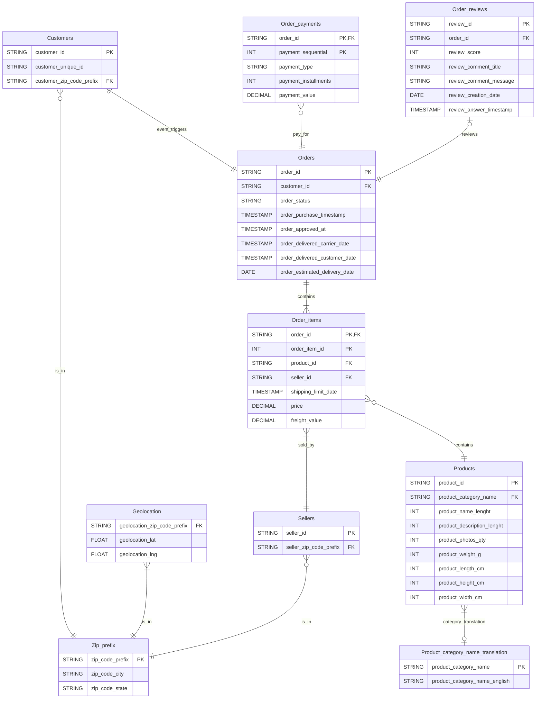

# Olist Data Model

Dimensional data model for the Olist Brazilian e-commerce dataset (9 tables, ~100k orders): source profiling, 3NF ERD, Kimball star schema with SCD Type 2, medallion layer plan and DDL for DuckDB and BigQuery. *(In progress)*

## Data Source

[Brazilian E-Commerce Public Dataset by Olist](https://www.kaggle.com/datasets/olistbr/brazilian-ecommerce), published on Kaggle under the CC BY-NC-SA 4.0 license.

> **The data is not included in this repo.** The raw CSVs (9 files, about 120 MB) are excluded by `.gitignore`. Download them from Kaggle before running anything.

## How To Run

Requires the [DuckDB CLI](https://duckdb.org/docs/installation/).

1. Download the dataset from Kaggle and unzip the 9 CSVs into a `data/olist/` folder **next to** this repo:

   ```
   parent-folder/
   ├── data/
   │   └── olist/            ← the 9 Olist CSVs (not in this repo)
   └── olist-data-model/     ← this repo
   ```

2. Open a terminal in the repo root and start DuckDB:

   ```
   duckdb
   ```

3. Create one view per source table (the paths are relative to the repo root):

   ```
   .read sql/00_views.sql
   ```

4. Run the profiling checks:

   ```
   .read sql/queries.sql
   ```

Plain `duckdb` runs in memory, so the views disappear when you exit. To keep them between sessions, open a database file instead with `duckdb olist.duckdb`. `.gitignore` excludes `*.duckdb` files.

## Logical Model (Hypothesis)

Hypothesis of how the database model behaves based on purely each entity and atribute visual information from the .csv



## Data Profiling

Each relationship in the hypothesis is tested against the data: hypothesis → checks → result → confirmed or revised. All queries are in [`sql/queries.sql`](sql/queries.sql).

### Orders ↔ Order_items

**Hypothesis :** `Orders ||--|{ Order_items`. Every item belongs to exactly one order, and every order has at least one item.

| **Check** | **Question** | **Result** | **Meaning** |
|-- | -- | -- | -- |
| 0 | Is `order_id` unique in orders? | 99,441 rows, 99,441 distinct | `order_id` is the primary key |
| 1 | Most items in one order | 21 | Many items per order |
| 2 | Orders with no items | **775** | An order can have **zero** items |
| 3a | Items with a NULL `order_id` | 0 | Every item has an order |
| 3b | Items whose `order_id` matches no order (orphans) | 0 | Every item's order exists |

**Why 775 orders have no items :**

| **Status** | **Orders** | **Reading** |
|-- | -- | -- |
| unavailable | 603 | **Business rule.** The order failed before any item was attached. |
| canceled | 164 | **Business rule.** Canceled orders can end up with no items. |
| created | 5 | **Ambiguous.** Could be orders still in progress or abandoned. |
| invoiced | 2 | **Data quality issue.** An invoiced order should have items. |
| shipped | 1 | **Data quality issue.** A shipped order must have items. |

**Result: revised.** `Orders ||--o{ Order_items`

- **`||` on the orders side :** Every item has exactly one order (checks 3a and 3b found no NULLs and no orphans).
- **`o{` on the order_items side :** An order has zero or many items. The "many" is confirmed by check 1, and the "zero" by check 2. The hypothesis assumed at least one item (`|{`), but 775 orders have none.

**Impact on the model :** Joining orders to order_items with an inner join drops 775 orders. Use a left join when counting orders, and decide in silver how to treat the 3 orders that are shipped or invoiced with no items.